# Board map

A long **spine** with six short detours that split and rejoin. Most of the
board is the shared route. If you qualify for a gated side you **choose**;
if you don't, you take the open side.

Layout source: `tools/gen_board_slots.py` → [board-slots.csv](board-slots.csv).
Card text: [actions.csv](actions.csv), [outcomes.csv](outcomes.csv).

---

## Walked length

You only walk **one** side of each fork.

| Strip | Tiles |
| --- | --- |
| Youth | 19 |
| College **or** work | 18 |
| Grad **or** career track | 9 |
| Buds ≤ −25 **or** open | 16 |
| Brawn ≥ +25 **or** open | 16 |
| Brains ≥ +75 **or** open | 16 |
| Buds ≥ +50 **or** open | 14 |
| Spine between events | 244 |
| Stops / fork tiles | 17 |
| **Typical path** | **~369 squares** |

Forks are **89 tiles** of a ~333-tile walked path (**~27%**). The rest is
spine. 12 payday tiles sit on the post-career spine only, so the route you
pick never changes salary count. Pre-career strips have no salary — career
starts at the Career stop. College vs work is tuition/gigs in *outcomes*.

~174 action slots × 30% land rate ≈ **~52 action landings** on a 1–6 spinner.

Spinner 1–6, land-only on action/outcome, paydays pay on pass, stops always
halt — unchanged.

---

## Sequence

Tiles listed are the **shared spine** unless marked as a split.

| After | Tiles | Then |
| --- | --- | --- |
| Start | **19** youth | University STOP |
| University | **18** college **or** 18 no-school | Career STOP |
| Career | **9** grad **or** 9 career-track | — |
| Those paths rejoin | **36** | Marriage STOP |
| Marriage | Buds ≤ −25 fork (**16**), then **25** spine | House I STOP |
| House I | **8** | Brawn ≥ +25 fork |
| Brawn fork | **16** gated **or** 16 open | — |
| Those paths rejoin | **31** | Children I STOP |
| Children I | Brains ≥ +75 fork (**16**), then **13** spine | House II STOP |
| House II | **15** | Children II STOP |
| Children II | **11** | House III STOP |
| House III | **9** | Buds ≥ +50 fork |
| Buds +50 fork | **14** gated **or** 14 open | — |
| Those paths rejoin | **26** | Children III STOP |
| Children III | **12** | Mid-life STOP |
| Mid-life | **20** | House IV STOP |
| House IV | **38** | Retirement STOP |

---

## Topology

```mermaid
flowchart TD
  start[Start] --> youth[Youth 19]
  youth --> uni[University STOP]
  uni --> college[College 18]
  uni --> work[No-school 18]
  college --> career[Career STOP]
  work --> career
  career --> grad[Grad 9]
  career --> job[Career track 9]
  grad --> rec1[Spine 36]
  job --> rec1
  rec1 --> m[Marriage STOP]
  m --> loneFork{Buds -25?}
  loneFork -->|yes: choose| lone[Lone 16]
  loneFork -->|no, or decline| olone[Open 16]
  lone --> s25[Spine 25]
  olone --> s25
  s25 --> house1[House I STOP]
  house1 --> s8[Spine 8]
  s8 --> brawnFork{Brawn +25?}
  brawnFork -->|yes: choose| brawn[Brawn 16]
  brawnFork -->|no, or decline| obrawn[Open 16]
  brawn --> rec2[Spine 31]
  obrawn --> rec2
  rec2 --> kid1[Children I STOP]
  kid1 --> scholarFork{Brains +75?}
  scholarFork -->|yes: choose| scholar[Scholar 16]
  scholarFork -->|no, or decline| oscholar[Open 16]
  scholar --> s13[Spine 13]
  oscholar --> s13
  s13 --> house2[House II STOP]
  house2 --> s15[Spine 15]
  s15 --> kid2[Children II STOP]
  kid2 --> s11[Spine 11]
  s11 --> house3[House III STOP]
  house3 --> s9[Spine 9]
  s9 --> socialFork{Buds +50?}
  socialFork -->|yes: choose| social[Social 14]
  socialFork -->|no, or decline| osocial[Open 14]
  social --> rec3[Spine 26]
  osocial --> rec3
  rec3 --> kid3[Children III STOP]
  kid3 --> s12[Spine 12]
  s12 --> midlife[Mid-life STOP]
  midlife --> s20[Spine 20]
  s20 --> house4[House IV STOP]
  house4 --> s38[Spine 38]
  s38 --> retire[Retirement STOP]
```

Seasons: youth + college/work = summer; career through House I = fall;
Children I through mid-life = winter; House IV to retirement = spring.

---

## Forks

Qualify → choose gated or open. Fail → open only. Both sides the same
length, **no extra paydays**, **roughly equal money**. The gated side leans
its actions at the required stat.

| Fork | Length | Gated side | Gate | Open side | Lean |
| --- | --- | --- | --- | --- | --- |
| Education | 18 | `college` | Chose undergrad | `work` | College: Brains / tuition. Work: Brawn / gig cash |
| Grad | 9 | `grad` | Has undergrad (may decline) | `career_track` | Grad: Brains, tuition. Career track: job flavor |
| Lone | 16 | `lone` | Buds ≤ **−25** | `open_lone` | Gated: isolation / Buds-down choices. Early — right after marriage |
| Brawn | 16 | `brawn` | Brawn ≥ **+25** | `open_brawn` | Gated: Brawn same-stat actions |
| Scholar | 16 | `scholar` | Brains ≥ **+75** | `open_scholar` | Gated: study, craft, late intellect. After Children I |
| Social | 14 | `social` | Buds ≥ **+50** | `open_social` | Gated: people, hosting, parent tiles |

No-school players cannot take `grad`. They can still take the stat forks.

---

## Stops, in order

| slot_id | Event |
| --- | --- |
| start | On the board |
| uni | University — college vs no-school |
| career | Career draw — then grad vs career-track |
| marriage | Marriage |
| fork-lone | Buds ≤ −25? |
| house1 | House I (first buy / rent) |
| fork-brawn | Brawn ≥ +25? |
| child1 | Children I |
| fork-scholar | Brains ≥ +75? |
| house2 | House II |
| child2 | Children II |
| house3 | House III |
| fork-social | Buds ≥ +50? |
| child3 | Children III |
| midlife | Mid-life crisis |
| house4 | House IV |
| retire | Retirement |

**Four** housing tiles. **Three** children tiles. Scripts:
[doc 04](../../04-life-events.md).

---

## Branch fill order

1. `youth` (19 slots)
2. `college` / `work` (18)
3. `grad` / `career_track` (9)
4. `lone` / `open_lone` (16)
5. `brawn` / `open_brawn` (16)
6. `scholar` / `open_scholar` (16)
7. `social` / `open_social` (14)
8. Spine strips — still most of the cards

Each strip wants at least as many action/outcome cards as slots of that type
on the strip. 2× is better so games don't repeat.
